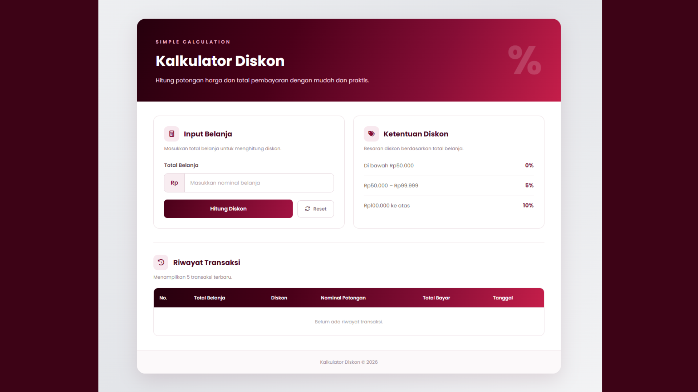

<div align="center">

# 🧮 KALKULATOR DISKON

**Aplikasi Perhitungan Diskon Belanja Berbasis Web**

Menghitung potongan harga secara otomatis dan menyimpan riwayat transaksi menggunakan PHP dan MySQL.

<br>


</div>

---

## 📌 Tentang Aplikasi

Kalkulator Diskon merupakan aplikasi berbasis web yang digunakan untuk menghitung diskon berdasarkan total belanja. Aplikasi ini menggunakan fungsi PHP `hitungDiskon()` untuk menentukan persentase diskon, menghitung nominal potongan, dan menghasilkan total pembayaran.

Hasil perhitungan juga disimpan ke dalam database MySQL sehingga pengguna dapat melihat riwayat transaksi terbaru.

## 📸 Tampilan Aplikasi

Aplikasi memiliki satu halaman utama dengan dua kondisi tampilan:

**1. Halaman Awal**

Tampilan sebelum pengguna memasukkan nominal belanja.

<p align="center">
  
</p>

**2. Hasil Perhitungan**

Tampilan setelah nominal belanja dimasukkan, menampilkan rincian diskon, total pembayaran, dan riwayat transaksi.

<p align="center">
  
</p>

## ✨ Fitur

- Input nominal total belanja.
- Perhitungan diskon secara otomatis.
- Menampilkan nominal potongan dan total pembayaran.
- Validasi input agar nominal yang dimasukkan sesuai.
- Penyimpanan transaksi ke database MySQL.
- Riwayat lima transaksi terbaru.
- Tombol reset untuk mengembalikan halaman ke kondisi awal.
- Tampilan responsif untuk berbagai ukuran layar.

## 📋 Ketentuan Diskon

| Total Belanja | Diskon |
|:---|:---:|
| ≥ Rp100.000 | 10% |
| ≥ Rp50.000 | 5% |
| < Rp50.000 | 0% |

### Rumus Perhitungan

```text
Nominal Diskon = Total Belanja × Persentase Diskon / 100

Total Pembayaran = Total Belanja - Nominal Diskon
```

### Contoh Kasus Perhitungan

Jika pengguna memasukkan total belanja sebesar **Rp120.000**, maka:

| Keterangan | Hasil |
|:---|---:|
| Total Belanja | Rp120.000 |
| Persentase Diskon | 10% |
| Nominal Diskon | Rp12.000 |
| **Total Pembayaran** | **Rp108.000** |

**Proses perhitungan:**

```text
Nominal Diskon = 120.000 × 10 / 100
               = 12.000

Total Pembayaran = 120.000 - 12.000
                 = 108.000
```

## 🛠️ Teknologi

| Teknologi | Kegunaan |
|:---|:---|
| PHP | Logika dan proses perhitungan |
| MySQL | Penyimpanan data transaksi |
| HTML5 | Struktur halaman |
| CSS3 | Desain dan tampilan |
| Font Awesome | Ikon aplikasi |
| Google Fonts | Font Poppins |
| XAMPP | Server lokal |
| phpMyAdmin | Pengelolaan database |

## 📁 Struktur Folder

```text
Tugas Pertemuan 6-8/
│
├── assets/
│   ├── style.css
│   └── img/
        ├── favicon.png
│       ├── halaman-awal.png
│       └── halaman-hasil.png
│
├── database/
│   └── db_diskon.sql
│
├── index.php
├── koneksi.php
└── README.md
```

## 💾 Database

Nama database: `db_diskon`

Nama tabel: `transaksi`

| Kolom | Tipe Data | Keterangan |
|:---|:---|:---|
| id | INT | Primary Key, Auto Increment |
| total_belanja | BIGINT | Total belanja |
| diskon | INT | Persentase diskon |
| nominal_diskon | BIGINT | Nominal potongan |
| total_bayar | BIGINT | Total pembayaran |
| tanggal | TIMESTAMP | Waktu transaksi |

### SQL Pembuatan Database

Terdapat dua cara untuk membuat database.

**1. Import File SQL**

1. Buka `http://localhost/phpmyadmin`.
2. Pilih menu **Import**.
3. Klik **Choose File**.
4. Pilih file `database/db_diskon.sql`.
5. Klik **Import** atau **Go**.
6. Tunggu hingga proses berhasil.

**2. Membuat Database Secara Manual**

1. Buka phpMyAdmin melalui browser.
2. Pilih menu **SQL**.
3. Masukkan dan jalankan kode berikut:

```sql
CREATE DATABASE IF NOT EXISTS db_diskon;

USE db_diskon;

CREATE TABLE IF NOT EXISTS transaksi (
    id INT AUTO_INCREMENT PRIMARY KEY,
    total_belanja BIGINT NOT NULL,
    diskon INT NOT NULL,
    nominal_diskon BIGINT NOT NULL,
    total_bayar BIGINT NOT NULL,
    tanggal TIMESTAMP DEFAULT CURRENT_TIMESTAMP
);
```

Setelah berhasil, database `db_diskon` beserta tabel `transaksi` akan terbentuk dan siap digunakan.

## 🚀 Cara Menjalankan Aplikasi

1. Install dan buka XAMPP.
2. Aktifkan **Apache** dan **MySQL**.
3. Letakkan folder `Tugas Pertemuan 6-8` di dalam direktori:

   ```text
   C:\xampp\htdocs\
   ```

4. Buat database menggunakan salah satu cara pada bagian Database.
5. Buka browser dan akses:

   ```text
   http://localhost/Tugas%20Pertemuan%206-8/
   ```

6. Aplikasi siap digunakan.

---

<div align="center">

**✨ Hitung Diskon dan Total Belanja dengan Mudah**

</div>